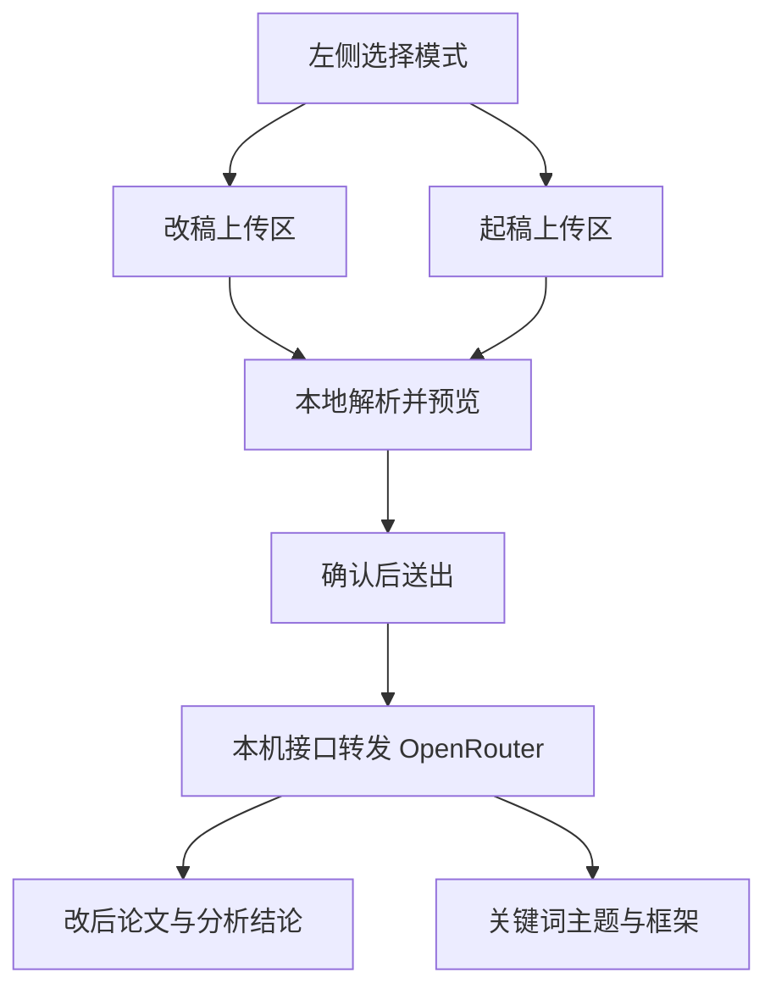

# 页缘：详细方案

会按这个方案开发。两条模式都有文档上传入口，不是只能粘贴。第一版先做可在浏览器里用完的网页，你验收通过后再做 Agent Skills。

## 需求怎么落地

- 选择「改稿」后，上传已写论文。系统改写措辞以降低与原文的字面重合、去掉模板化的 AI 套话，同时做多维分析。结果是处理后的论文，加上分析结论；结论里每一条都有具体建议。
- 选择「起稿」后，上传论文要求、开题或想法。系统抽出关键词和主题，给出构思、写作指导，以及可以照着做的章节框架。
- 页面响应式，桌面和手机都能完成上传、处理和下载。
- 模型通过 OpenRouter 接入。密钥用环境变量或页面设置，不写进仓库。
- 每次处理完成后，提交的原文、改后论文和分析或起稿内容写入「存档」板块。用户之后随时从该板块打开查看，刷新页面仍然在。
- 网页跑通并验收后，再把同一套规则做成两个 Agent Skills。

已有规则会写进提示词：[humanizer-zh](/cursor/stores/bc-4d70aef1-499f-4e48-832e-2389337d9c2a/docs/humanizer-zh/cases-output.md) 负责改写时保住事实、数字、引用和语气；[scientific-writing](/cursor/stores/bc-4d70aef1-499f-4e48-832e-2389337d9c2a/docs/scientific-writing/SKILL.md) 负责不编文献、不编数据、结论不越出证据。`frontend-design`、`UI-UX-Pro-Max`、`perplexity-search`、skills creator 目前还不在项目里。若开发前你放进来，实现时先读再调整界面或检索步骤。

降重和降 AI 痕迹做成可见的改写结果：改后正文、仍与原文大段重合的位置、被去掉和仍留着的套话。不输出伪装成知网、Turnitin 或 GPTZero 的百分比，那些分数对不上真实检测器，也不能当作结论。

## OpenRouter 的作用

OpenRouter 是模型网关，只负责「读入文本、按提示词写出改稿或框架」。它不是页面，也不负责存论文。

浏览器不直接调用 OpenRouter。用户点开始之后，正文先到本机的 Next.js 接口，接口再用 OpenAI SDK 把请求发到 `https://openrouter.ai/api/v1/chat/completions`。这样密钥留在服务端或随本次请求从本机设置带入，页面源码里不写死密钥。

它在两条模式里各做语言工作：

- **改稿**：按章节改写措辞，并生成六维分析结论和带摘句的具体建议。改写和分析是两次调用，避免边改边评时丢掉原文事实。
- **起稿**：从要求与想法里抽出关键词、主题，并写出构思、指导和章节框架。这是一次调用。

下面这些不经过 OpenRouter，本机完成：

- 拖拽、选择文件、粘贴，以及 Word、PDF、Markdown、纯文本的解析和预览。
- 章节切分、字数和超限判断。
- 改后正文与原文的连续字面重叠。
- 页边批注的排版、下载 Markdown 和 docx、存档的保存与再打开。

没有密钥时，上传、解析和预览仍然可用，主按钮说明需要密钥，不会假装已经改完。设置里可以换模型 slug，默认用 OpenRouter 上适合长文的当前别名。网页和后来的两个 skills 共用这一层封装，避免两套模型口径。

## 上传入口

工作台只有一页。左侧书脊切换模式，中间纸页顶部始终是上传区。两种模式的上传区各自独立，切换模式不会把上一份文件偷偷送去另一种处理。

改稿上传区，未选文件时占纸页上半：

- 虚线纸边框，文案是「把已经写好的论文放在这里」。
- 拖拽文件到框内，或点击框内按钮打开系统文件选择器。
- 接受 `.docx`、`.pdf`、`.txt`、`.md`，单文件，不超过 15 MB。
- 选中后先在浏览器里解析，此时还不调用模型。成功则显示文件名、大小、字数、识别出的章节目录，以及前约 400 字预览。
- 主按钮「开始降重并分析」只在解析出正文后可点。
- 次入口「改为粘贴」展开文本框，给没有文件的人。粘贴和上传二选一，后选的覆盖先选的，页面写明当前用的是哪一份。
- 处理过程中上传区收成一条文件信息，可「换一篇」。换篇会清空本次结果。

起稿上传区，结构相同，文案换成「把论文要求、开题或你的想法放在这里」：

- 同样支持拖拽、点击选择，格式与大小限制相同。
- 文件下方保留一个补充框，用来写文件里没有的想法。文件和补充至少有一项非空。
- 主按钮是「提取关键词并生成框架」。

解析失败时停在上传区，不进入处理：扫描版 PDF 没有文字层、加密或损坏的文件、空文档，各自有一句原因和下一步（换成 Word、导出文字版 PDF，或改为粘贴）。

## 改稿：处理步骤与输出

用户点「开始降重并分析」后，先弹出一句确认：正文会经本机接口发到 OpenRouter。取消则留在预览。

服务端步骤：

1. 接收已解析的纯文本、文件名和文稿类型（中文课程论文/毕业论文，或英文研究稿）。
2. 按标题或空行切成章节。单节过长再按段落切块，每块大约 3000 到 6000 字，带上章节标题，避免改写丢上下文。
3. 逐块改写。要求换句式和用词，降低与原文的连续字面重合；同时遵守 humanizer-zh：不改数字、引用标记、引号内原文、限定语和作者已经写明的不确定。不新增文献、数据、方法和结论。
4. 在本地计算改后文本与原文的连续片段重叠，列出仍然大段相同的位置。这一步不调用模型。
5. 用改后全文再做一次分析，生成结论和建议。分析看的是改后稿，并对照原文标出没改动的重合段。

页面结果分三块，都可下载：

- **处理后的论文**：完整改后正文，按原章节标题排好。可下载 Markdown 和 docx。
- **分析结论**：先是一段总判断，然后六个维度各自一段结论。
  - 结构是否缺摘要、绪论、文献、方法、结果、讨论、结论；英文稿改为 IMRaD。
  - 研究问题是否具体，结论有没有写成证据没支撑的话。
  - 证据与引用缺在哪里，哪里把相关写成了因果。只指出缺口。
  - 套话与机械感：点名模板句和过于整齐的句式，并说明改写已经动过哪些、还剩哪些。
  - 措辞重叠：仍与原文连续重合的片段。
  - 事实风险：没有依据却写死的数字、范围或因果。
- **具体建议**：结论不能只有评语。每条建议包含章节位置、原文摘句、问题、建议怎么改、以及这一处不允许编造的内容。建议显示在右侧页边，细线指回正文对应段。点击一条，正文滚到该段。

单次正文上限约 4 万字。超出时不截断默默处理，而是停下来说明请先按章拆开再上传。处理中按章节依次出现改后段落，失败时保留已解析的原文，方便重试。

## 起稿：处理步骤与输出

点「提取关键词并生成框架」后同样先确认外发。输入是要求文件的正文，加上补充框里的想法。

输出固定五项目，缺信息就写成「还未确定」，不用空话补齐：

- **关键词**：从要求里抽出的词，并标出哪个词来自题目、哪个来自用户想法。
- **主题**：一两句说清这篇要讨论的问题范围。
- **构思**：候选研究问题、这项工作做到哪为止、明确不做什么。
- **指导**：建议的写作顺序，以及每一章动笔前要先准备的材料。
- **框架**：可执行的章节树。每一节写明目的、这一节要写的内容、需要的证据或材料、尚未解决的问题。中文毕业论文默认摘要、绪论、文献、研究设计、分析、讨论、结论；英文研究稿默认 IMRaD。用户要求里若指定了目录，框架改跟那个目录，不强行套模板。

起稿不生成整篇论文，也不编参考文献。若以后有检索 skill，只把「作者应去核对的公开问题」列进未决项。

## 存档板块

工作台增加一块「存档」，和起稿、改稿放在一起。处理成功后自动写入一条记录，用户不用另点保存。之后从这块打开，就能再看当时提交的内容和处理后的内容。

一条改稿记录保存：

- 提交的论文原文、文件名、字数、文稿类型、提交时间
- 修改后的论文全文
- 分析结论、六维判断、逐条建议、仍重合的片段

一条起稿记录保存：

- 提交的要求或想法原文，以及补充框里的文字
- 关键词、主题、构思、指导和章节框架

打开一条记录时，纸页用三个页签切换「提交稿」「修改稿」「分析与建议」。起稿记录的后两页改为「框架」和「指导」，没有改后论文时不显示修改稿页签。页边批注跟着当前页签变化。从存档打开只读，不重新调用模型。

存档列表按时间倒序，每行显示模式、文件名或题目摘句、时间。可以删除单条。空列表写明：完成一次改稿或起稿后，原文和结果会出现在这里。

数据放在本机 IndexedDB，不上传到单独的存储服务，也不做账号。同一台浏览器里刷新、关掉再打开都能看到。换浏览器或清站点数据后，这些记录不在。最多保留 30 条，超出时提示删旧记录后再处理新的一篇，避免悄悄丢稿。

## 界面

视觉参考 Shelf 的暖纸、左栏和具体句子，产品本身是批注过的文稿，不是收藏夹，也不做等待列表。

- 底色暖纸，字为墨色，朱砂只用于未完成项和模式印章。正文 Noto Serif SC，界面标签 Familjen Grotesk。
- 桌面三栏：左书脊是「起稿 / 改稿 / 存档」；中栏是上传区或从存档打开的纸页；右栏是批注、框架，或存档列表。选中存档时，中栏用页签在提交稿、修改稿、分析与建议之间切换。
- 手机：顶栏三个入口；存档是一张列表，点进后才是纸页和页签；批注与框架收进底部抽屉，抽屉标题显示建议条数。
- 设置抽屉：OpenRouter 密钥、模型 slug。密钥只留在 localStorage。
- 无密钥时上传和本地预览仍可用，主按钮改为说明需要密钥。另有「看一份样例批注」，用短示例展示页边建议长什么样，并标明这是样例。

按钮、输入、对话框和抽屉用 shadcn/ui。纸页、上传区和批注线是单独画的，不用现成仪表盘布局。

## 技术与文件

Next.js App Router、TypeScript、Tailwind、shadcn/ui。开发服务用非默认端口，避开 3000、5173、8080。

- [app/page.tsx](app/page.tsx)：工作台，模式、上传、结果都在这一页。
- [components/upload-well.tsx](components/upload-well.tsx)：拖拽、文件选择、粘贴、解析状态。两个模式共用组件，文案和按钮由模式传入。
- [components/margin-notes.tsx](components/margin-notes.tsx)：改稿建议；起稿时改为框架面板。
- [lib/parse-document.ts](lib/parse-document.ts)：docx 用 mammoth，pdf 用 unpdf，文本直接读取。解析在浏览器完成，接口只收纯文本。
- [lib/overlap.ts](lib/overlap.ts)：本地计算连续片段重叠。
- [lib/archive.ts](lib/archive.ts)：用 IndexedDB 保存和读回存档。密钥不放进存档。
- [lib/prompts/revise.ts](lib/prompts/revise.ts)、[lib/prompts/analyze.ts](lib/prompts/analyze.ts)、[lib/prompts/conceive.ts](lib/prompts/conceive.ts)：网页和后续 skill 共用。
- [app/api/revise/route.ts](app/api/revise/route.ts)、[app/api/conceive/route.ts](app/api/conceive/route.ts)：用 OpenAI SDK，`baseURL` 为 `https://openrouter.ai/api/v1`。请求头带站点名。流式返回改写段落；分析结论和起稿结果以 JSON 收尾。
- 默认模型用 OpenRouter 当前的长上下文别名，设置里可改。密钥优先读 `OPENROUTER_API_KEY`，否则用请求里用户本机填的密钥。
- 无账号、无服务器数据库。论文原文和结果只存在这台浏览器的 IndexedDB。导出用浏览器生成 Markdown 和 docx。

改写和分析的模型输出都要求 JSON 或带章节标记的文本，服务端校验缺字段就返回错误，不把半截说明当成论文。

## 测试与验收

开发按下面顺序做，每步能在页面上检查后再做下一步。

1. 骨架和两个上传区：拖入、点击选择、粘贴、错误文件、换一篇。此步不接模型。
2. 起稿接上 OpenRouter：关键词、主题、构思、指导、框架五项目都出现，缺信息处写「还未确定」。
3. 改稿接上：上传后得到完整改后正文，数字和引用与原文一致，重叠片段被标出。
4. 分析结论：总判断、六维结论、逐条建议（含摘句和改法）显示在页边，并可随正文下载。
5. 存档：处理成功后列表出现新记录；刷新后仍可打开提交稿、修改稿和分析或框架；删除后列表不再显示该条。
6. 密钥缺失、超长、解析失败、桌面与手机宽度。你验收网页。
7. 通过后再写 skills。

自动检查：重叠计算、章节切分、空文件和超限判断有单元测试。提示词测试确认改写指令包含「不新增文献和数据」。有密钥时用一份短 docx 和一份短 txt 走通两条接口；没有密钥时页面预览和报错仍要测到。

你验收时看这些是否成立：

- 改稿页能拖入或点选一份 Word、PDF 或文本，看到字数和预览，再得到改后论文。
- 分析结论里有总判断，并且至少有几条带摘句和改法的建议。
- 起稿页能上传要求或想法，看到关键词、主题、构思、指导和章节框架。
- 手机宽度下上传、处理和阅读结果不需要横滑整页。
- 没有密钥时不会假装已经改完。
- 完成一次改稿后，存档里能再打开提交的论文、修改后的论文和分析建议；刷新页面后仍然在。

## 验收后再做的 Skills

在 [.cursor/skills/yeyuan-revise/SKILL.md](.cursor/skills/yeyuan-revise/SKILL.md) 和 [.cursor/skills/yeyuan-conceive/SKILL.md](.cursor/skills/yeyuan-conceive/SKILL.md) 各写一份技能说明：何时使用、输入是本地文件或粘贴、步骤指向上面三份提示词、禁止编造文献和检测器分数。技能读取用户给出的文件，调用同一 OpenRouter 封装，把改后稿或框架写回用户指定路径。网页未验收前不开始这一步。
